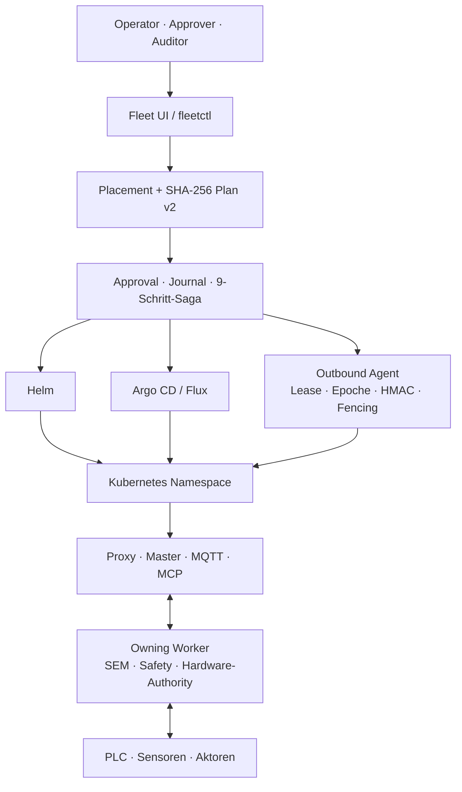

# Automation Control Plane

<p align="center">
  
</p>

<p align="center">
  <strong>Deterministische und nachweisbare Orchestrierung verteilter Automation, ohne Safety-, Hardware- oder Node-Authority aus dem besitzenden Worker zu verlagern.</strong>
</p>

<p align="center">
  <a href="README.md">English</a> ·
  <a href="docs/ARCHITECTURE.md">Architektur</a> ·
  <a href="kubernetes_orchestration/documentation/VALIDATION_RESULTS_V0027_R3.json">Validierung</a> ·
  <a href="SECURITY.md">Security</a>
</p>

## Rollout zentral steuern, Authority lokal bewahren

Automation Control Plane trennt Management und Maschinenautorität. Proxy,
Master, MQTTS, PostgreSQL und MCP übernehmen Authentifizierung, Registry,
Relay, Mirror, Audit und langlebigen Plattformzustand. Der additive Fleet-
Dienst erzeugt unveränderliche, SHA-256-gebundene Rolloutpläne und führt sie
über Helm, Argo CD, Flux oder outbound-only Cluster-Agenten aus. SEM, Safety,
Scope-Revision, Feldbus und finale Aktuatorentscheidung bleiben im owning Worker.

`0.27.3 / v0027-r3` erhält alle 588 Dateien der Control Plane `v0026-r1`
byteidentisch. Das Automation-System-Runtime-Archiv bleibt separat und
digestgebunden.

## Kernnutzen

- Erklärbares Placement über Capabilities, Labels, Failure Domains und Ausschlussgründe.
- Unveränderlicher Plan v2 mit neun journalisierten Saga-Schritten.
- Genau ein Write Owner je Ziel: Helm, Argo CD oder Flux.
- Technisches Vier-Augen-Prinzip und Freigaben je Rolloutwelle.
- Pause/Resume und idempotente Fortsetzung ohne Planänderung.
- Outbound-Agenten mit Kubernetes-Lease, zentraler Epoche, HMAC und Fencing.
- Digestgeprüfte Evidence-Bundles, Audit-Hashkette und Prometheus/Grafana-Artefakte.

## Architektur



Die tiefe technische Diagnose steht in
[`docs/ARCHITECTURE.md`](docs/ARCHITECTURE.md).

## Schnellstart

```bash
git clone https://github.com/Centaurus-X/Automation_Control_Plane.git
cd Automation_Control_Plane
./start_orchestration.sh
./status_orchestration.sh
```

Die UI bindet an `127.0.0.1:9080`. Kubernetes-Mutationen bleiben gesperrt, bis
`FLEET_ALLOW_MUTATIONS=1` nach Zielsystemabnahme bewusst aktiviert wird.

## Reifegrad und Grenzen

Der Releasezustand lautet bewusst `PASS_WITH_EXTERNAL_GATES_OPEN`: Integrität,
Byteidentität, statische/functional Tests, Runtime-Bindung und Release-Gates
sind dokumentiert bestanden. Reale Registry-, Helm-, kubectl-, Cluster-, CNI-,
Storage-, PKI-, PostgreSQL- und GitOps-Abnahmen bleiben verpflichtend offen.
Kubernetes ist nicht der Hard-RT-Pfad; der Linux/systemd-Worker bleibt für
Hardware- und Echtzeitprofile bevorzugt.

## Lizenz

Das öffentliche Repository steht unter [GNU GPL v3.0 only](LICENSE). Weitere
Informationen: [CONTRIBUTING.md](CONTRIBUTING.md), [SECURITY.md](SECURITY.md)
und [COMMERCIAL_LICENSE.md](COMMERCIAL_LICENSE.md).

---

<p align="center">
  Über Jahre um eine unveränderte Regel gebaut: Zentrale Koordination darf
  führen, aber der maschinenbesitzende Node bleibt die finale Authority.
</p>
