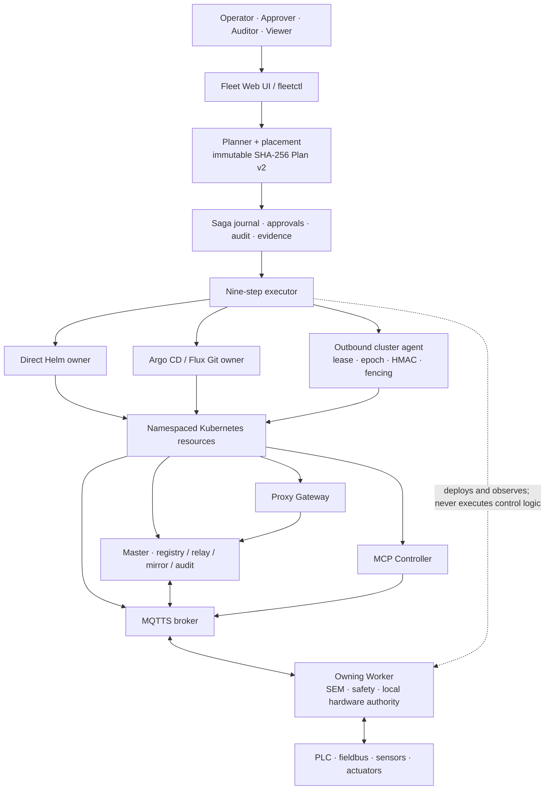

# Automation Control Plane

<p align="center">
  
</p>

<p align="center">
  <strong>Deterministic, evidence-backed orchestration for distributed automation—without moving safety, hardware or node authority out of the owning Worker.</strong>
</p>

<p align="center">
  <a href="https://github.com/Centaurus-X/Automation_Control_Plane/actions/workflows/quality.yml"></a>
  <a href="https://github.com/Centaurus-X/Automation_Control_Plane/releases"></a>
  
  
  <a href="LICENSE"></a>
</p>

<p align="center">
  <a href="README.de.md">Deutsch</a> ·
  <a href="#quick-start">Quick start</a> ·
  <a href="docs/ARCHITECTURE.md">Architecture</a> ·
  <a href="kubernetes_orchestration/documentation/VALIDATION_RESULTS_V0028_R1.json">Validation</a> ·
  <a href="SECURITY.md">Security</a>
</p>

---

## Control the rollout, preserve the authority

Industrial automation needs central visibility and repeatable deployment, but
the management plane must not quietly become the owner of real hardware.
Automation Control Plane separates these responsibilities:

- Proxy, Master, MQTT, PostgreSQL and MCP provide authenticated coordination,
  registry, relay, mirroring, audit and durable platform state.
- The additive Fleet service creates immutable, SHA-256-bound plans and applies
  them through direct Helm, Argo CD, Flux or outbound-only cluster agents.
- The owning Automation System Worker retains SEM, safety, scope revision,
  fieldbus and final actuator authority.

Release `0.28.0 / v0028-r1` preserves all 588 files of the embedded `v0026-r1`
Control Plane byte-for-byte and promotes the Linux/Helm portability patch into
a complete successor package. Helm image templates now parse correctly, and
all nine strict subchart schemas accept Helm's reserved `global` values tree.
The orchestration layer remains a separate management boundary; the runtime
remains a separately digest-bound release.

## Who it is for

- OT/platform teams operating distributed automation services across clusters.
- System integrators who need deterministic rollout, rollback and evidence.
- Security architects reviewing identity, RBAC, approval and trust boundaries.
- Automation engineers who require node-local control to survive management-plane outages.
- Teams introducing GitOps or outbound agents without changing hardware authority.

## What you can achieve

- Plan multi-target releases deterministically from inventory, policy, catalog and desired state.
- Explain placement by labels, capabilities, failure domains, ranking and exclusion reasons.
- Enforce exactly one write owner per target: Helm, Argo CD or Flux.
- Require separate operator/approver identities and optional per-wave approval.
- Pause and resume an unchanged nine-step rollout without duplicating completed work.
- Reach restricted clusters through an outbound-only, lease-fenced, signed agent channel.
- Export digest-verified evidence and an append-only audit hash chain.
- Observe plans, agents, workload health and rollout metrics from CLI or web UI.

## Engineering capabilities

| Capability | Operational outcome | Evidence in `v0028-r1` |
|---|---|---|
| Immutable Plan v2 | Every target, chart, descriptor, value and policy input is digest-bound. | Deterministic planner and tamper tests. |
| Nine-step Saga | Discovery through verification is journaled and resumable. | `discover → validate → render → diff → preflight → backup → apply → wait → verify`. |
| Deterministic placement | Target selection is explainable rather than opportunistic. | Capability, label, failure-domain and exclusion contracts. |
| Write ownership | Direct Helm and GitOps paths cannot mutate the same target concurrently. | Owner validation, provider dispatch and rollback tests. |
| Outbound cluster agent | Fleet can operate targets without an inbound management listener. | Kubernetes leader lease, central epoch, HMAC and fencing. |
| Four-eyes approval | A plan creator cannot approve their own rollout. | Role, creator-binding and per-wave gates. |
| Evidence and audit | Operators can archive a verifiable release trail. | Per-step digests, bundle export and audit hash-chain checks. |
| Authority preservation | Cluster management never becomes field-I/O authority. | External runtime digest binding and explicit Worker boundary. |

> [!IMPORTANT]
> This is a **pre-production release with external acceptance gates open**. The
> static, functional, integrity and runtime-binding gates recorded in the
> release passed. A production declaration still requires the real target
> registry, Helm/kubectl, Kubernetes API, CNI, storage, PKI, PostgreSQL, GitOps,
> image supply chain and failure/recovery tests listed in the target acceptance guide.

## Architecture at a glance



The detailed architecture, authority matrix, rollout sequence, failure model,
performance considerations and release diagnosis are in
[Architecture](docs/ARCHITECTURE.md). Standalone source:
[`control-plane-components.mmd`](docs/diagrams/control-plane-components.mmd).

## Quick start

### Requirements

- Linux with Python 3.12+ for the Fleet service and validation tools.
- Docker/Compose for the packaged Control Plane services.
- Helm 3 and `kubectl` for direct Kubernetes deployment.
- An OCI registry with immutable image digests for target rollout.
- Target-specific PKI, PostgreSQL, storage and CNI for production acceptance.

### Read-only Fleet UI

```bash
git clone https://github.com/Centaurus-X/Automation_Control_Plane.git
cd Automation_Control_Plane

./start_orchestration.sh
./status_orchestration.sh
```

The UI binds to `127.0.0.1:9080`. Setup creates separate Admin, Operator,
Approver, Auditor and Viewer credentials outside the release tree. Kubernetes
mutations remain disabled until `FLEET_ALLOW_MUTATIONS=1` is explicitly set.

### Deterministic rollout workflow

```bash
./kubernetes_orchestration/scripts/setup.sh
CONFIG="$HOME/.config/automation-fleet/fleet.json"
PLAN=/tmp/automation-plan.json

./kubernetes_orchestration/fleetctl.sh --config "$CONFIG" validate
./kubernetes_orchestration/fleetctl.sh --config "$CONFIG" plan --output "$PLAN"

PLAN_ID="$(python3 -c 'import json,sys; print(json.load(open(sys.argv[1]))["plan_id"])' "$PLAN")"
./kubernetes_orchestration/fleetctl.sh --config "$CONFIG" approve --plan-id "$PLAN_ID"

FLEET_ALLOW_MUTATIONS=1 \
  ./kubernetes_orchestration/fleetctl.sh --config "$CONFIG" apply --plan "$PLAN"
```

Do not enable mutations until target acceptance, secrets, backups, image
digests, RBAC and recovery procedures are ready.

## Deployment paths

| Path | Write owner | Intended boundary |
|---|---|---|
| Direct Helm | `helm` | Fleet calls typed Helm/kubectl operations against a reachable target. |
| Outbound agent | `helm` with `agent` execution mode | Target agent polls Fleet and executes a signed, fenced task locally. |
| Argo CD | `gitops_argocd` | Fleet changes only the bound Git worktree and observes Argo reconciliation. |
| Flux | `gitops_flux` | Fleet changes only the bound Git worktree and observes Flux readiness. |
| Observe-only | none | Inventory and health collection without mutation. |

Ten charts, including the optional umbrella chart, cover Fleet, cluster agent,
Master, Proxy, MQTT, MCP Controller, soft-runtime, PostgreSQL integration and
observability boundaries. The Linux/systemd Worker remains the preferred path
for hardware and real-time profiles.

## Validation and evidence

```bash
./test_release.sh
sha256sum -c SHA256SUMS
```

The packaged validation record reports:

- 899 archive files and 898 internal manifest entries.
- 588 preserved `v0026-r1` files with byte-identity `PASS`.
- 35 functional Fleet Python modules and 9 Python test files.
- Planner, placement, lifecycle, provider, approval, agent, API, audit and evidence tests `PASS`.
- JavaScript, JSON, static YAML, shell, Helm-boundary and runtime-binding gates `PASS`.
- 54 external Automation Runtime tests `PASS` in the recorded release build.
- Explicit `SKIP`, not `PASS`, for live Helm/kubectl/cluster/registry/CNI/storage/PKI/PostgreSQL/GitOps gates.
- Deterministic ZIP construction and an external SHA-256 sidecar.

See the machine-readable
[validation result](kubernetes_orchestration/documentation/VALIDATION_RESULTS_V0028_R1.json)
and normative [target acceptance checklist](kubernetes_orchestration/documentation/KUBERNETES_TARGET_ACCEPTANCE_DE.md).

## Performance model

Planning is deterministic and bounded by target count, component count, chart
rendering and provider calls. Rollouts are wave-based and intentionally favor
traceability, idempotency and recovery over maximum mutation throughput. The
Fleet service is outside the real-time/control path; its outage does not stop
already running Kubernetes workloads or authorized local Worker automation.

No universal rollout-time, cluster-count or control-loop latency claim is
published. Benchmark target discovery, render/diff, apply/readiness, evidence
size, agent polling and journal growth using representative clusters and
failure modes. Local field-control timing must be qualified independently on
the Worker/hardware path.

## Repository map

```text
control_plane_v0026_r1/        byte-preserved Proxy/Master/MQTT/PostgreSQL/MCP baseline
kubernetes_orchestration/
  src/automation_fleet/        planner, placement, journal, executor, providers, API
  component_descriptors/       provider-neutral component contracts
  config/ and schemas/         inventory, desired state, policy and validation
  deploy/                      Helm, Compose, systemd and image builds
  tests/ and tools/            functional, integrity and release gates
  web/                         role-aware Fleet operator UI
  documentation/               architecture, security, operations and acceptance
BASELINE_INPUTS.json           immutable input/digest boundary
SHA256SUMS                     complete publication manifest
```

## Known boundaries

- Production target acceptance is not included in the source-only release record.
- Fleet is not a high-availability domain authority and must not be treated as one.
- Kubernetes Hard-RT is explicitly disallowed without separate qualification.
- Database schema rollback is never automatic; backups and manual recovery are required.
- A namespace writer is privileged inside that namespace and must be strongly protected.
- Local token authentication is suitable for isolated operation; broader exposure needs TLS/OIDC at the edge.
- Multiple independent Fleet instances with separate journals are not a supported active-active topology.

## Documentation

- [Architecture and technical diagnosis](docs/ARCHITECTURE.md)
- [Kubernetes architecture](kubernetes_orchestration/documentation/ARCHITEKTUR_KUBERNETES_ORCHESTRATION_DE.md)
- [v0028-r1 patch diagnosis](kubernetes_orchestration/documentation/DIAGNOSE_UND_IMPLEMENTIERUNG_V0028_R1_DE.md)
- [v0028-r1 release validation](kubernetes_orchestration/documentation/RELEASE_VALIDATION_V0028_R1_DE.md)
- [Operations guide](kubernetes_orchestration/documentation/BETRIEBSANLEITUNG_DE.md)
- [Security model](kubernetes_orchestration/documentation/SICHERHEITSMODELL_DE.md)
- [Agent and GitOps runbook](kubernetes_orchestration/documentation/RUNBOOK_AGENTEN_UND_GITOPS_DE.md)
- [Target acceptance](kubernetes_orchestration/documentation/KUBERNETES_TARGET_ACCEPTANCE_DE.md)
- [Original release README](docs/ORIGINAL_RELEASE_README_V0027_R3_DE.md)

## Security

Use GitHub private vulnerability reporting. Never put credentials, certificates,
kubeconfigs, agent tokens, plant data or vulnerability details in public issues.
Read [SECURITY.md](SECURITY.md).

## Contributing and license

Read [CONTRIBUTING.md](CONTRIBUTING.md). The public project is licensed under
[GNU GPL v3.0 only](LICENSE). Separate commercial licensing or engineering work
may be discussed for integration, architecture, hardening, deployment and
target acceptance; see [Commercial licensing](COMMERCIAL_LICENSE.md).

---

<p align="center">
  Built over years around one enduring rule: central coordination may guide the
  system, but the machine-owning node must remain the final authority.
</p>
