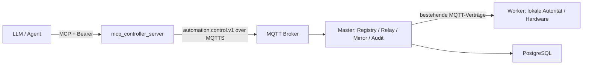

# mcp_controller_server 0.1.0 / v0001-r1

Eigenständige, funktional implementierte AI/KI-Schnittstelle, vollständig
integriert in das Automation-Control-Plane-Bundle `0.26.0 / v0026-r1`. Die
Komponente stellt MCP-Tools, Ressourcen und Prompts bereit und kommuniziert mit
der Plattform ausschließlich über MQTTS und den vorhandenen Master-Vertrag
`automation.control.v1`.

Sie öffnet keine Verbindung zur Plattform-Datenbank, spricht keine Worker
direkt an, publiziert keine frei wählbaren MQTT-Topics und bietet weder Shell-
noch Terminalzugriff. Schreibende Aktionen laufen über einen zweistufigen
Prepare-Approve-Commit-Prozess mit exaktem SHA-256-Digest und stabiler
Idempotenz-ID.

## Lieferumfang

- MCP über Streamable HTTP (`POST /mcp`) und lokales stdio;
- stateless MCP-Version `2026-07-28` sowie Legacy-Kompatibilität für
  `2025-11-25`, `2025-06-18` und `2025-03-26`;
- 8 lesende und 3 kontrollierte Workflow-Tools;
- MQTT-mTLS, Bearer-Authentifizierung, RBAC und Site-Scopes;
- externer Freigabeworkflow, lokaler SQLite-Zustand und append-only Auditlog;
- begrenzter, nicht dauerhafter Cache für Master-Events und Sensorwerte;
- rootless/read-only Docker-Deployment, Healthchecks und Lifecycle-Skripte;
- vollständige v0026-Integration in Root-Lifecycle, Rollout, Administration,
  Orchestration, Monitoring, Tests, SBOM und Release-Manifeste;
- dependency-freie Unit-, Integrations-, Vertrags- und Security-Tests.

## Systemgrenze



Die einzige Plattformkante ist MQTT. `controller.sqlite3` ist nur ein lokaler
Freigabe- und Idempotenzspeicher; sie ist keine Plattform-DB.

## Integrierte Identität

Das v0026-Bundle verwendet ausschließlich die dedizierte Identität:

```text
source.service:     proxy
source.instance_id: mcp-controller-01
certificate:        urn:automation:site-main:proxy:mcp-controller-01
```

Die Broker-ACL erlaubt Master-Control-Kommandos, den eigenen ACK-Pfad und
Master-Events. Worker- und Broadcast-Kommandotopics sind nicht freigegeben.

## Rollout im Gesamtbundle

Bevorzugt wird der Root-Installer:

```bash
cd "$HOME/automation_control_plane_release_v0026_r1"
sh ../rollout_automation.sh \
  --archive "$HOME/automation_control_plane_release_v0026_r1.zip" \
  --worker-archive "$HOME/automation_system_v0101.zip" \
  --fresh
```

Der Installer erzeugt die externe Auth-Datei aus
`mcp_controller.local_agent.token`, stellt Test-PKI oder Produktions-PKI bereit
und deployt in der Reihenfolge:

```text
database -> mqtt -> master -> proxy -> mcp_controller_server -> worker
```

## Direkter Komponentenbetrieb

Voraussetzungen: Docker Compose v2, Netzwerk `automation_control`, laufender
Broker/Master und vollständige externe Auth-/PKI-Quellen.

```bash
export MCP_MQTT_CA_SOURCE=/secure/mcp-controller/mqtt_ca.crt
export MCP_MQTT_CERT_SOURCE=/secure/mcp-controller/mcp_mqtt.crt
export MCP_MQTT_KEY_SOURCE=/secure/mcp-controller/mcp_mqtt.key
export MCP_AUTH_SOURCE=/secure/mcp-controller/mcp_auth.json
./preflight.sh
./deploy.sh
./ready.sh
```

HTTP bindet standardmäßig nur an `127.0.0.1:8080`. Entfernte Clients benötigen
einen authentifizierten TLS-Reverse-Proxy.

## Lokaler stdio-Client

```bash
export MCP_CONTROLLER_CONFIG=/absolute/path/config/controller_config.json
PYTHONPATH=src python3 -m mcp_controller_server.main stdio
```

Der mitgelieferte stdio-Principal ist read-only. Auch stdio greift über MQTT auf
den Master zu.

## Verwaltung

```bash
./preflight.sh
./deploy.sh
./status.sh
./test.sh
./backup.sh
./restart.sh
./logs.sh
./stop.sh
```

Rollback erfordert ein vorhandenes, unveränderliches Image:

```bash
MCP_CONTROLLER_ROLLBACK_IMAGE=registry.example/mcp-controller:0.0.9 \
  ./rollback.sh
```

## Dokumentation

- [Tiefe Bestands- und Architekturdiagnose](docs/ARCHITECTURE_ANALYSIS_DE.md)
- [MCP-Interface](docs/MCP_INTERFACE_DE.md)
- [MQTT-Vertrag](docs/MQTT_CONTRACT_DE.md)
- [Deployment und v0026-Integration](docs/DEPLOYMENT_DE.md)
- [Security-Modell](docs/SECURITY_DE.md)
- [Betrieb und Administration](docs/OPERATIONS_DE.md)
- [Tests und Verifikation](docs/TESTING_DE.md)
- [Bundle-Integration](../documentation/MCP_CONTROLLER_INTEGRATION_V0026_R1_DE.md)

## Release-Integrität

`SHA256SUMS` schützt jede Komponentendatei außer sich selbst. Das Root-Manifest
schützt zusätzlich die komplette Bundle-Position. `RELEASE_METADATA.json`
dokumentiert sowohl die Komponentenidentität `0.1.0 / v0001-r1` als auch die
Bindung an `0.26.0 / v0026-r1`.
