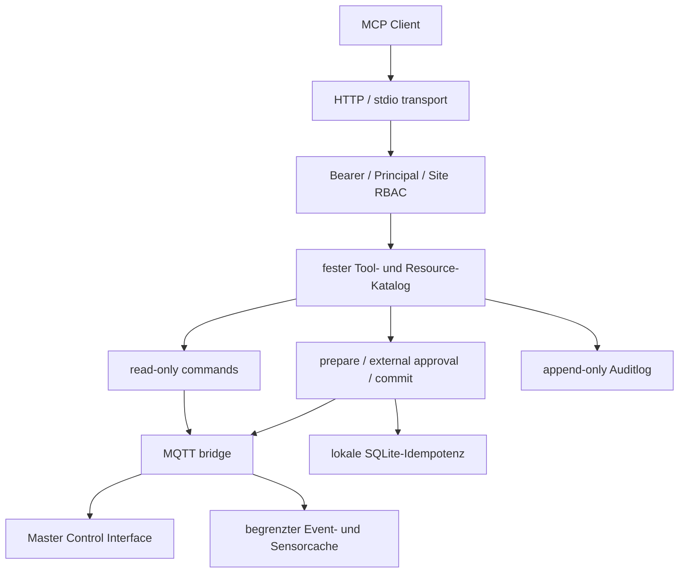

# Tiefe Bestands- und Architekturdiagnose

## Analysierter und integrierter Stand

Für die Bundle-Integration wurden die beiden bereitgestellten Release-Archive
vor dem Merge vollständig auf äußeren SHA-256, ZIP-CRC, Traversalpfade, absolute
Pfade, Backslashes, Symlinks, Duplikate und interne Manifeste geprüft:

| Archiv | SHA-256 | Ergebnis |
|---|---|---|
| `automation_control_plane_release_v0025_r1.zip` | `1e4396d25a0d2a896a139d46188d7e1d90c4c5580a5e82ab7a50a5082fb7473d` | PASS; 545 ZIP-Einträge, 482 extrahierte Dateien |
| `mcp_controller_server_release_v0001_r1.zip` | `16c42b77b9583ced7287a8c3138567f124e63864b9e9afdd962570fd911c202b` | PASS; 84 Dateien |

Die ursprüngliche MCP-Komponente war zuvor gegen Control Plane v0025-r1 und den
separaten Worker v0101 entwickelt worden. Diese Herkunft bleibt in
`PROVENANCE.md` nachvollziehbar. Das hier dokumentierte Ziel ist jedoch das
zusammengeführte Bundle `0.26.0 / v0026-r1`.

## Systemmodell nach dem Merge

Das Gesamtsystem trennt Verantwortlichkeiten weiterhin klar:

| Komponente | Autorität | MCP-Bezug |
|---|---|---|
| PostgreSQL | dauerhafte Control-Plane-Daten | ausschließlich indirekt über Master-Kommandos |
| MQTT Broker | authentifizierter Message-Bus mit CN-basierter ACL | einzige Plattform-Transportkante des MCP-Servers |
| Master | Registry, Relay, Konfigurations-Mirror, Operationen und Audit | einziges erlaubtes MCP-Ziel |
| Proxy | öffentliche Client-Authentifizierung, RBAC, HTTPS/WSS | bleibt unverändert die öffentliche API-Grenze |
| MCP Controller Server | MCP-Transport, eigener Principal/RBAC, Toolkatalog, Freigabepläne | eigenständige interne Integrationskomponente |
| Worker | lokale Autorität, SEM-Single-Writer, Rules und Feldbus/Hardware | niemals direkt von MCP angesprochen |
| Administration | immutable Plan, Fencing, Idempotenz, Rollout und Rollback | verwaltet MCP als reguläre sechste Komponente |

Die Worker sind im Modus `node_local` die ausführende Wahrheit. Der Master darf
Anforderungen prüfen, spiegeln und weiterleiten, aber keine Feldbusoperationen
selbst ausführen. Worker greifen nicht direkt auf PostgreSQL zu. Diese
Invarianten bleiben durch den MCP-Server unverändert.

## Relevante Datenflüsse

1. Worker senden Status, Heartbeats, Registrierungen,
   Konfigurationszustände und Ereignisse über ihre vorhandenen MQTT-Topics.
2. Der Master normalisiert akzeptierte Sensordaten als Control-Event
   `sensor.value` und publiziert sie unter seinem Event-Topic.
3. Proxy und MCP verwenden denselben bestehenden Master-Control-Vertrag mit
   `source.service=proxy`, aber verschiedene zugelassene Instanzidentitäten:
   `proxy-01` und `mcp-controller-01`.
4. Der MCP-Server besitzt dafür ein eigenes mTLS-Zertifikat und eine eng
   begrenzte ACL; er verwendet weder Proxy-Key noch Proxy-Zertifikat.
5. Der Master validiert Topic und Envelope, Principal-Berechtigungen,
   Site-Scope, Idempotenz, Ablaufzeit und sein dauerhaftes Inbox-Modell und
   antwortet mit einer an `causation_id` gebundenen `command.ack`.
6. Node-lokale Konfigurationsänderungen werden unverändert als
   `config_scope_operations_v1` an den zuständigen Worker weitergeleitet. Epoch,
   Scope-Revision und Fingerprint schützen gegen Lost Updates und falsche
   Autorität.

## Harte Integrationsgrenzen

### Kein direkter Datenbankzugriff

Die Komponente importiert keinen PostgreSQL-Treiber und besitzt keine
Plattform-DB-Zugangsdaten. Lesende Werkzeuge wie `config.get`, `config.history`
oder `operation.get` gehen als Control-Kommando an den Master. Die lokale
SQLite-Datei speichert ausschließlich MCP-Freigabepläne und Commitzustände.

### Kein Worker-Bypass

Es gibt weder Worker-Topics noch Worker-IDs als frei wählbare
Transportparameter. Der MCP-Server kann ausschließlich die fest kodierten
Master-Kommandos erzeugen. Damit bleiben Node-Autorität, SEM und die vorhandenen
Safety-Policies wirksam.

### Kein generischer MQTT-Zugang

Tool-Aufrufe akzeptieren weder Topic noch Eventnamen. Der Katalog ist statisch;
auch `terminal.execute`, `node.admission.approve`, `config.rollback` und rohe
Publish-Funktionen sind bewusst nicht exponiert.

### Secrets außerhalb des Releasebaums

Bearer-Authentisierung und Produktions-PKI werden nicht in das ZIP geschrieben.
`rollout_automation.sh` erzeugt aus der geschützten Credentials-Datei ein
externes Auth-Dokument mit restriktiven Rechten. Der Orchestrator bindet nur den
Pfad und dessen erwartete Konfiguration, nicht den Secretwert in Plan, Audit
oder Evidence.

## Historische Deployment-Lücke in v0025-r1

v0025-r1 definierte im Orchestrator und Component-Adapter exakt fünf
Komponenten:

```text
database -> mqtt -> master -> proxy -> worker
```

Die Registry-Validierung wies eine sechste Komponente deshalb korrekt ab. Diese
Lücke lag nicht in MQTT oder MCP, sondern im festen Administration-Schema.

## Auflösung in v0026-r1

v0026-r1 erweitert den bestehenden Mechanismus additiv auf:

```text
database -> mqtt -> master -> proxy -> mcp_controller_server -> worker
```

Die Integration umfasst:

- zentrale Registry-, Inventory- und Release-Manifest-Einträge;
- feste Abhängigkeit `mcp_controller_server` nach Proxy und vor Worker;
- vollständige Adapteroperationen `preflight`, `backup`, `apply`, `ready`,
  `status`, `test`, `restart` und `rollback`;
- unveränderte Locks, Fencing-Tokens, Idempotency-Keys, Checkpoints, Audit,
  Evidence, Resume und Reverse-Order-Rollback;
- Aufnahme in Vollinstaller, Compose-Lifecycle, Status, Logs, Static-, Running-
  und Extended-Gates;
- dedizierte Test-PKI, Produktions-PKI-Handoff, MQTT-ACL und Master-Allowlist;
- bundleweite Vertragsprüfung der Identität, Rechte, Abhängigkeiten,
  Secret-Hygiene und Release-Metadaten.

Ein separater, außerhalb des zentralen Orchestrators ausgeführter
MCP-Deploymentpfad ist für das v0026-Bundle nicht mehr erforderlich.

## Identität im Bundle

Die verbindliche Bundle-Identität lautet:

```text
source.service:     proxy
source.instance_id: mcp-controller-01
certificate CN:     urn:automation:<site>:proxy:mcp-controller-01
```

Die Wiederverwendung von `proxy-01` ist nur als historische
Standalone-Kompatibilitätsidee dokumentiert und wird im integrierten Bundle
nicht unterstützt. Damit bleiben Revocation, ACL, Audit-Zuordnung und
Zertifikatsrotation unabhängig vom Proxy.

## Zielarchitektur der Komponente



Der MQTT-Bridge übernimmt strikte Topic-/Envelope-Korrelation, verwirft retained
Control-Nachrichten, begrenzt Queue und Pending Requests, verwendet QoS 1 und
wiederholt dieselbe idempotente Nachricht bis zum anwendungsspezifischen ACK.

## Bewusste Grenzen von Version 0.1.0

- Der Event-/Sensorcache enthält nur Ereignisse seit der letzten Verbindung und
  ist keine historische Datenquelle.
- Eine Instanz pro State-Volume ist vorgesehen. Aktive/aktive Replikation des
  lokalen SQLite-Freigabespeichers ist nicht Bestandteil dieser Version.
- Native HTTPS-Terminierung ist nicht enthalten. Der Container bindet deshalb
  standardmäßig nur an Loopback; Remote-Zugriff benötigt einen
  TLS-Reverse-Proxy.
- Die Datenbank wird bei einem Komponenten-Rollback nicht blind automatisch
  zurückgesetzt; persistenter Zustand kann eine fachliche manuelle Recovery
  erfordern.
- Live-Readiness setzt eine funktionierende MQTT-mTLS-Verbindung zum Zielsystem
  voraus und fällt ohne diese Verbindung geschlossen aus.
