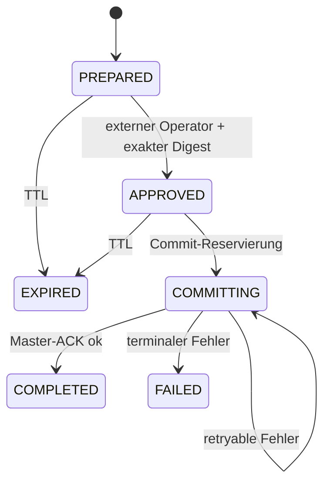

# Security-Modell

## Sicherheitsziele

1. Ein Modell erhält nur explizit autorisierte, strukturierte Fähigkeiten.
2. Kein MCP-Aufruf kann Master, Worker-Autorität, SEM oder Broker-ACL umgehen.
3. Schreiboperationen sind nachvollziehbar, digest-gebunden und wiederholsicher.
4. Transportidentität, Envelope-Identität, Site und ACK-Korrelation stimmen
   vollständig überein.
5. Secrets und interne Exceptions erscheinen nicht in Antworten oder Logs.

## Kontrollen

| Risiko | Kontrolle |
|---|---|
| unautorisierter MCP-Client | zufälliger Bearer-Token, konstante Digest-Prüfung, Rate Limit |
| Cross-Site-/DNS-Rebinding | exakte Origin-Allowlist, Loopback-Default |
| MQTT-Mitm | CA-Prüfung, Servername, Clientzertifikat, kein Insecure-Default |
| Topic-/Event-Injection | feste Tool-Mappings, normalisierte Topic-Tokens, kein Raw Publish |
| Prompt-Injection auf Schreibpfad | Server-RBAC plus Prepare–Approve–Commit außerhalb des Modells |
| Replay/Doppelwirkung | Plan-ID als UUID, Digest, SQLite-Zustand, MQTT-Idempotency-Key |
| falsches ACK | Topic-, Quelle-, Ziel-, Causation-, Correlation- und Command-Prüfung |
| Überlast | Body-, Queue-, Cache-, Pending-, Packet- und Rate-Limits |
| Container-Escape-Folgen | Non-root, read-only, Cap-Drop, no-new-privileges |
| Datenbank-Bypass | kein Plattform-DB-Treiber, keine DB-Secrets, MQTT-only Static Gate |
| Secret-Leak | keine Payloads im Audit, neutrale Fehler, keine Access Logs |

## Berechtigungsmodell

Jeder Bearer-Client besitzt einen festen Principal mit:

- `subject`
- `permissions`
- `site_scopes`
- optionalen `resource_scopes`

Vor jedem Master-Kommando prüft der Server sowohl die erforderliche Permission
als auch den Site-Scope. Der Principal wird vollständig in den bestehenden
Control-Envelope übernommen; der Master führt seine eigene Prüfung zusätzlich
aus. MCP-RBAC ersetzt damit keine bestehende Policy, sondern bildet eine zweite
Schicht.

## Externe Freigabe

Ein `prepare` speichert die exakte Aktion/Payload lokal, gibt an den Client aber
nur Plan-ID, Digest und Ablaufzeit zurück. `approve` benötigt denselben Digest
und einen Operator-Identifier. `commit` ist nur für dasselbe Subject möglich.

Zustandsmaschine:

Bei Crash in `COMMITTING` wird mit derselben Plan-/MQTT-ID fortgesetzt. Ein
bereits terminaler Plan wird nie erneut publiziert.

## Lokale Daten

`controller.sqlite3` enthält aktive Plan-Payloads. `audit.jsonl` enthält keine
Payload, Tokens oder Zertifikate, sondern nur Identitäten, Tool, Entscheidung,
Reason-Code, Plan-/Digest- und MQTT-IDs. Beide liegen im privaten State-Volume.

Das Auditlog wird mit `O_APPEND`, `0600`, `fsync`, `O_NOFOLLOW` soweit verfügbar
und Regular-File-Prüfung geschrieben. Für manipulationssichere Langzeitaufbewahrung
soll es zusätzlich an ein externes Write-Once/SIEM-Ziel exportiert werden.

## Secret-Rotation

- Bearer: neuen Clientdatensatz ergänzen, Container neu starten, Client umstellen,
  alten Datensatz entfernen und erneut starten.
- MQTT-Zertifikat: neues Secret bereitstellen, Container neu erstellen, altes
  Zertifikat in der PKI widerrufen.
- MQTT-Zertifikat `mcp-controller-01`: Zertifikat und Key der dedizierten
  MCP-Identität gemeinsam rotieren; Proxy- und Worker-Zertifikate bleiben davon
  unabhängig.

## Residualrisiken

- Ein kompromittierter Client mit Mutation-Permissions kann gültige Pläne
  vorbereiten; externe Freigabe bleibt die entscheidende Trennung.
- Ein kompromittierter externer Operator kann vorbereitete exakte Pläne
  freigeben. Vier-Augen-Prinzip oder signierte Freigaben sind nicht in 0.1.0.
- Ein Standalone-Kompatibilitätsmodus mit `proxy-01` ist im integrierten
  v0026-Bundle nicht unterstützt; das Bundle erzwingt `mcp-controller-01`.
- Der RAM-Telemetriecache ist nicht vollständig und darf nicht als Audit- oder
  Historienquelle interpretiert werden.
- Bearer über Remote-HTTP ist nur mit vorgeschaltetem TLS sicher.

## Nicht unterstützte Konfigurationen

- `allow_insecure_transport=true` außerhalb isolierter Tests
- `insecure_skip_verify=true`
- Remote-Bindung ohne TLS-Reverse-Proxy
- Secrets im ZIP, Image, Git oder `.env`
- direkte Freigabe durch dasselbe unkontrollierte Modell im Produktionsbetrieb
- mehrere aktive Instanzen auf demselben SQLite-State-Volume
