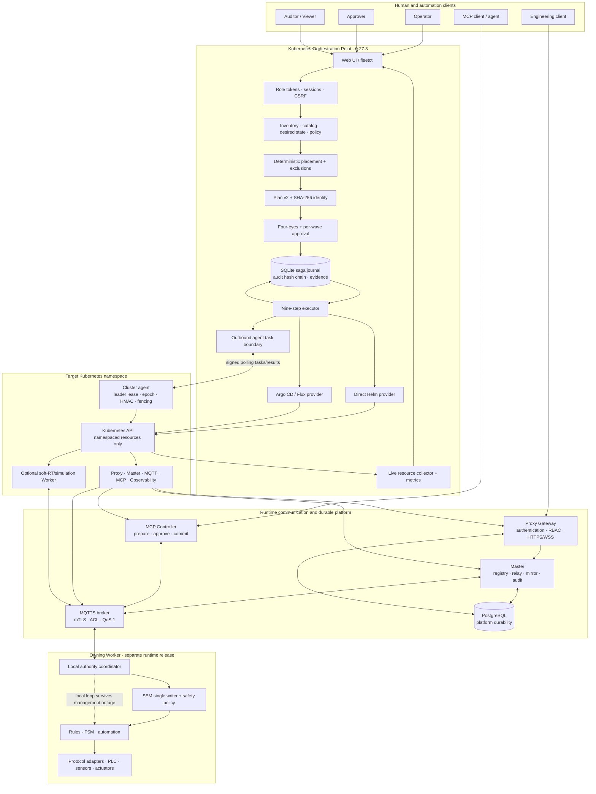
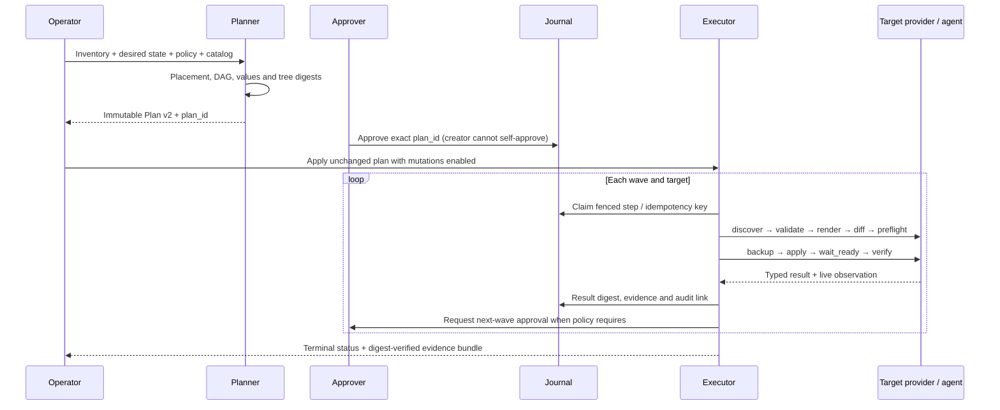

# Automation Control Plane architecture and technical diagnosis

## Executive assessment

Automation Control Plane `0.27.3 / v0027-r3` combines two deliberately separate
layers:

1. the byte-preserved `v0026-r1` platform for Proxy, Master, MQTTS,
   PostgreSQL and MCP-mediated control workflows; and
2. the additive Kubernetes Orchestration Point for deterministic deployment,
   placement, approvals, agents, GitOps, observation and evidence.

This separation is technically important. Fleet owns deployment state and its
journal; it never owns Node configuration, SEM, safety, scope revisions,
hardware addresses or actuator execution. Those remain with the owning Worker.
The public product claim should therefore be “controlled orchestration without
authority inversion,” not “Kubernetes controls the plant.”

## End-to-end component architecture

Standalone source: [`diagrams/control-plane-components.mmd`](diagrams/control-plane-components.mmd).

## Authority and state ownership

| State / decision | Final owner | Why |
|---|---|---|
| Fleet inventory, desired state, policy and plan | Fleet | Deployment-management intent. |
| Approval, wave state, Saga steps, evidence and Fleet audit | Fleet journal | Reproducible orchestration and recovery. |
| Kubernetes object reconciliation | Exactly one target write owner | Prevents Helm/GitOps races. |
| Registry, relay, mirror and Control Plane audit | Master | Distributed coordination, not field authority. |
| User authentication, RBAC and public HTTP/WSS boundary | Proxy | Keeps client trust separate from Worker execution. |
| Durable Master/Proxy platform data | PostgreSQL | Transactional platform state. |
| Node config, SEM, safety, scope revision and hardware I/O | Owning Worker | Local availability and fail-closed machine authority. |

## Plan and rollout lifecycle

Pause/resume never changes a plan. Each step is idempotency-bound; failures stop
later waves. Rollback uses an existing provider revision where possible. A new
install without a safe prior revision or a database migration that cannot be
reversed results in explicit manual recovery rather than a false success.

## Provider and agent boundaries

- `helm/direct`: typed subprocess arguments invoke Helm/kubectl against a
  preflighted context and namespace.
- `helm/agent`: an outbound-only target agent receives the same typed work.
  Local Kubernetes leader election plus a central monotonic lease epoch fences
  stale replicas. Target, plan, step, idempotency key, fencing token, epoch,
  HMAC and result digest must all match.
- `gitops_argocd` and `gitops_flux`: Fleet changes only the bound clean worktree,
  commits/pushes a deterministic manifest and waits for the named reconciler.
  It does not also call Helm directly.
- `observe_only`: collector access without plan mutation.

## Control Plane communication path

Normal clients authenticate at Proxy, which forwards valid operations through
Master and MQTTS to the owning Worker. MCP clients use a separate bearer/RBAC
boundary and the dedicated broker identity `mcp-controller-01`, but still use
the same `automation.control.v1` route. The MCP service has no platform database
access and no direct Worker channel. Write workflows use prepare–approve–commit
with stable digest and idempotency identity.

## Security model

- Read-only is the default; mutation requires explicit runtime enablement.
- Operator and Approver are separated; the creator cannot approve their plan.
- Browser mutation is Same-Origin/CSRF-bound with signed HttpOnly/SameSite sessions.
- Tokens must be external files with restrictive permissions; inline secrets are rejected.
- Workloads use non-root, read-only roots, dropped capabilities and RuntimeDefault seccomp.
- RBAC is namespace-scoped; there is no `pods/exec`, ClusterRole, CRD or admission webhook.
- Images are rendered as immutable `repository@sha256:digest` references.
- Plans bind charts, descriptors, values, inputs and target ownership by SHA-256.
- Evidence verifies step digests and the full audit hash chain.

The simple token system is an isolated/local boundary. Organization-wide
exposure requires authenticated TLS and external identity lifecycle such as
OIDC at the edge. See [SECURITY.md](../SECURITY.md).

## Availability and failure behavior

| Failure | Expected behavior |
|---|---|
| Fleet unavailable | Existing workloads and local Worker automation continue; new rollouts stop. |
| Target API unavailable | Current step fails/pauses with evidence; later waves do not begin. |
| Agent leader loss | A new local leader must obtain a current central epoch; stale results are rejected. |
| GitOps controller not ready | Provider waits/fails; no fallback direct writer is activated. |
| MQTT/Master outage | Remote convergence degrades; already authorized node-local control remains local. |
| Initial install failure | No fictitious rollback revision; manual recovery is explicit. |
| Database migration failure | Automatic schema rollback is forbidden; restore/runbook applies. |

## Performance model

Fleet is intentionally outside the control-loop critical path. Planner cost
scales with targets, selected components, chart trees and values. Execution
time is dominated by provider calls, image pulls, Kubernetes scheduling,
storage, readiness and wave policy. Agent polling trades immediacy for an
outbound-only network boundary.

Measure at least plan generation, render/diff, apply-to-ready, per-wave idle
time, agent round-trip, evidence size, journal growth and collector duration.
Report cluster version, target count, chart/component count, registry/storage
conditions and failure injection. Do not translate orchestration timing into a
field-control latency claim.

## Release integrity diagnosis

The release carries a complete root `SHA256SUMS`, an audit inventory and bound
digests for the preserved Control Plane, external runtime and architecture
inputs. `VALIDATION_RESULTS_V0027_R3.json` deliberately reports
`PASS_WITH_EXTERNAL_GATES_OPEN`: static and functional gates passed while live
target infrastructure gates were skipped. This distinction is correct and
should remain visible in every public release.

## Diagnostic conclusion

The product has a strong and credible position where deployment governance and
runtime authority are usually conflated. Its nine-step, evidence-first Saga,
single write owner and double-fenced agent path are substantive technical
differentiators. The honest boundary is equally important: production fitness
is determined only after real cluster, network, storage, PKI, database, GitOps,
failure and recovery acceptance—not by source tests alone.
